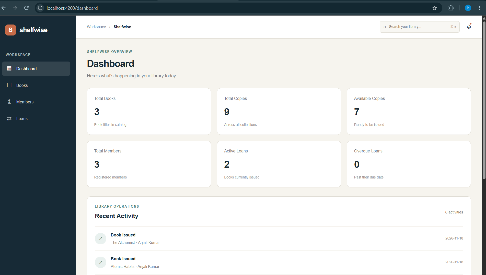
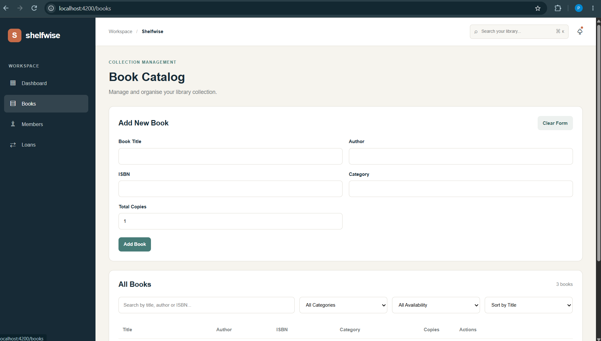
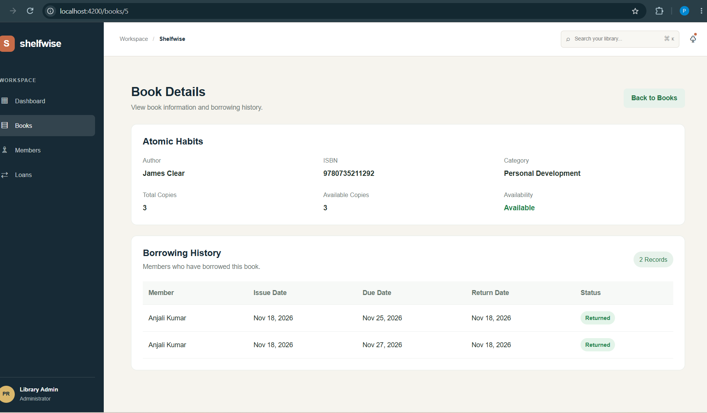
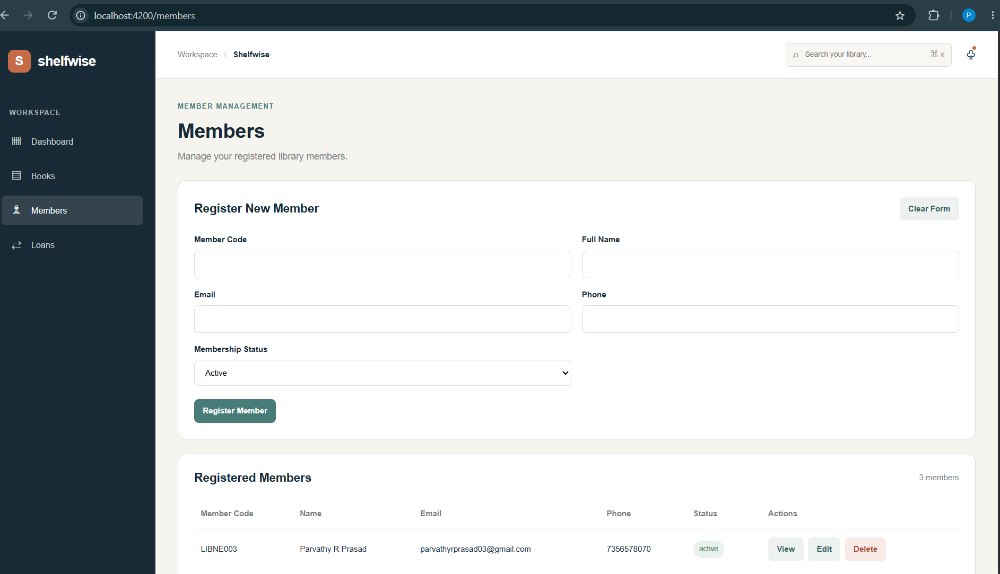
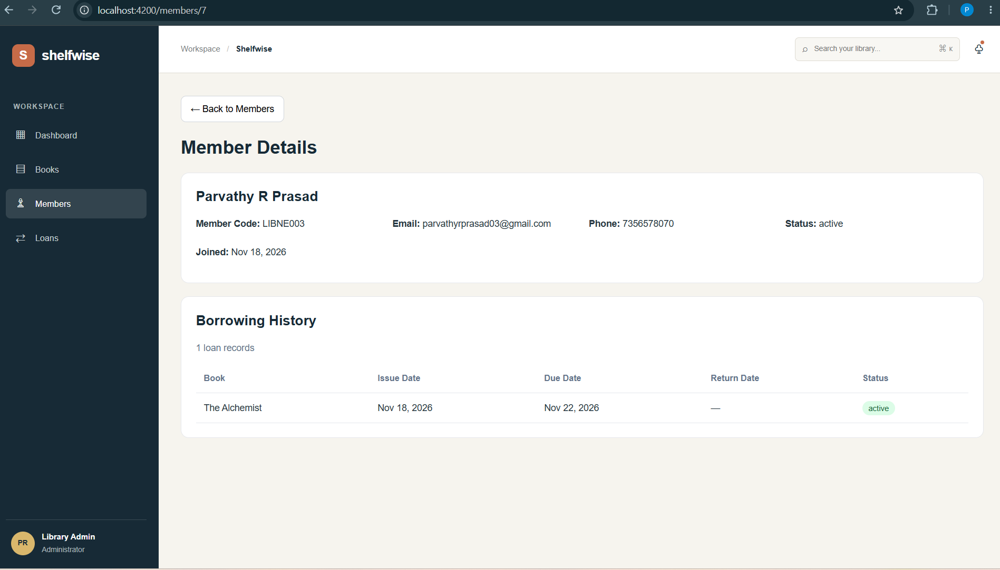

# Shelfwise – Library Management System

Shelfwise is a full-stack Library Management System developed using Angular, Go, and PostgreSQL. It provides a centralized platform to manage books, library members, and borrowing activities while tracking book availability and loan status.

## Technologies Used

### Frontend
- Angular 22
- TypeScript
- HTML
- SCSS (Sass)
- CSS

### Backend
- Go (Golang)
- REST APIs

### Database
- PostgreSQL

## Features

### 1. Dashboard
- View total books and total copies.
- Track available copies.
- View registered members.
- Monitor active and overdue loans.
- View recent library activities.

### 2. Book Management
- Add, view, edit, and delete books.
- Search books by title, author, and ISBN.
- Filter books by category and availability.
- Sort book records.
- View book details and borrowing history.

### 3. Member Management
- Register new members.
- View, edit, and delete member records.
- Manage member status.
- View individual member details and borrowing history.

### 4. Loan Management
- Issue books to active members.
- Set due dates for borrowed books.
- Return borrowed books.
- Track active and returned loans.
- Prevent issuing unavailable books.
- Prevent duplicate returns.
- Detect overdue loans.

## Project Structure

```text
LibraryManagementSystem/
│
├── backend/
│   ├── cmd/
│   │   └── api/
│   │       └── main.go
│   ├── internal/
│   │   ├── database/
│   │   ├── handlers/
│   │   ├── middleware/
│   │   ├── models/
│   │   ├── repositories/
│   │   └── services/
│   ├── migrations/
│   ├── go.mod
│   └── go.sum
│
├── frontend/
│   └── library-management/
│       ├── src/
│       ├── public/
│       ├── angular.json
│       └── package.json
│
├── screenshots/
│
└── README.md
```

## Prerequisites

Make sure the following are installed:

- Go
- Node.js and npm
- Angular CLI
- PostgreSQL
- Visual Studio Code (recommended)

## Installation and Setup

### 1. Clone the Repository

```bash
git clone https://github.com/Parvathyrprasad/Shelfwise.git
cd Shelfwise
```

### 2. Database Setup

- Make sure PostgreSQL is running.
- Create a PostgreSQL database for the application.
- Configure the database connection settings in the backend.
- Run the SQL migration available in `backend/migrations/001_create_library_tables.sql`.

### 3. Backend Setup

Navigate to the backend directory:

```bash
cd backend
```

Download Go dependencies:

```bash
go mod download
```

Start the backend server:

```bash
go run ./cmd/api
```

The backend API runs at:

http://localhost:8080

### 4. Frontend Setup

Open another terminal and navigate to the Angular application:

```bash
cd frontend/library-management
```

Install dependencies:

```bash
npm install
```

Start the Angular development server:

```bash
ng serve
```

Open the application in your browser:

http://localhost:4200

## Build

To create a production build, navigate to the Angular application directory and run:

```bash
ng build
```

The build output is generated in the `dist/` directory.

## Screenshots

The following screenshots demonstrate the application's main screens.

### Dashboard


### Book Management


### Book Details


### Member Management


### Member Details


### Loan Management
.png)

## Validation and Error Handling

The application includes:

- Required-field validation.
- Book availability validation.
- Active member validation.
- Due date validation.
- Duplicate return prevention.
- Inventory limit protection.
- Overdue loan detection.

## Styling

The frontend uses SCSS for styling.

- Global stylesheet: `src/styles.scss`
- Angular component styles are configured to use SCSS.
- SCSS variables and nested selectors are used in the global stylesheet.

## Conclusion

Shelfwise is a full-stack Library Management System developed using Angular, TypeScript, Go, and PostgreSQL. It provides functionality for managing books, members, and borrowing activities through an organized application.